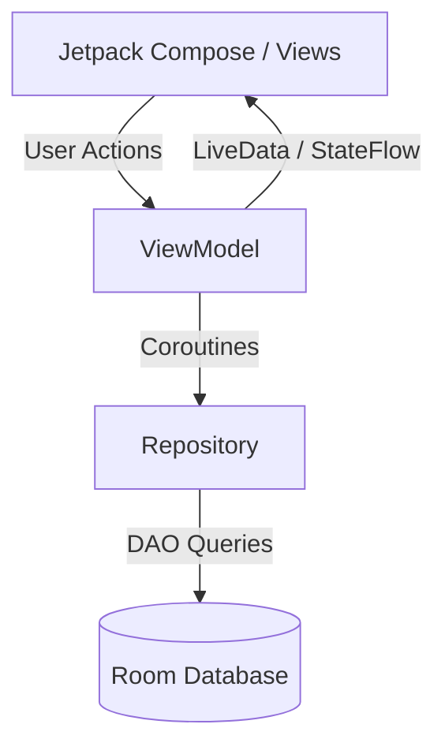

# BÁO CÁO ĐỒ ÁN TỐT NGHIỆP / ĐỒ ÁN CHUYÊN NGÀNH
## Đề tài: Ứng dụng Quản lý Nhà trọ "NHÀ TRỌ VIỆT" trên Android

---

## 1. Giới thiệu ứng dụng
**NHÀ TRỌ VIỆT** là một ứng dụng di động chạy trên nền tảng Android, được thiết kế và phát triển nhằm hỗ trợ chủ đầu tư, chủ nhà trọ quản lý hệ thống nhà trọ, phòng trọ, khách thuê, hợp đồng thuê phòng, hóa đơn điện nước và tài chính thu chi một cách chuyên nghiệp, chính xác và tiện lợi.

## 2. Mục tiêu xây dựng
- Số hóa toàn bộ quy trình quản lý nhà trọ thủ công (sổ sách, excel) lên thiết bị di động.
- Tự động hóa việc tính toán tiền điện, nước, hóa đơn hàng tháng và thống kê doanh thu/lợi nhuận.
- Cung cấp giao diện trực quan, thân thiện với người dùng theo phong cách Material Design 3 và Jetpack Compose.
- Đảm bảo tính bảo mật, lưu trữ dữ liệu an toàn cục bộ bằng Room Database (không phụ thuộc internet).

## 3. Công nghệ sử dụng
- **Ngôn ngữ**: 100% Kotlin.
- **UI Framework**: Jetpack Compose & Material 3, XML Layouts (interoperability).
- **Navigation**: Navigation Compose & Activity Intent routing.
- **Kiến trúc**: MVVM (Model - View - ViewModel) Architecture.
- **Xử lý bất đồng bộ**: Kotlin Coroutines & LiveData / Flow.
- **Cơ sở dữ liệu**: Room Database (SQLite abstraction).

## 4. Sơ đồ Kiến trúc Hệ thống (MVVM)

## 5. Sơ đồ Cơ sở Dữ liệu (Room Entities)
- **Users**: Quản lý tài khoản đăng nhập (id, username, password, fullName, phone).
- **Houses (NhaTro)**: Quản lý thông tin dãy trọ / nhà trọ (id, tenNhaTro, diaChi, moTa, giaMacDinh).
- **Rooms (Phong)**: Quản lý phòng trọ (id, nhaTroId, tenPhong, dienTich, giaThue, trangThai, moTa).
- **Tenants (KhachThue)**: Quản lý khách thuê (id, phongId, hoTen, sdt, cmnd, queQuan, ngaySinh, gioiTinh).
- **Contracts (HopDong)**: Quản lý hợp đồng (id, phongId, khachThueId, ngayBatDau, ngayKetThuc, tienCoc, giaThue, trangThai).
- **Invoices (HoaDon)**: Quản lý hóa đơn hàng tháng (id, phongId, thangNam, chỉ số điện nước, tổng tiền, trạng thái).
- **Transactions (ThuChi)**: Quản lý thu chi tài chính (id, loai, soTien, noiDung, ngay, ghiChu).

## 6. Mô tả Chức năng Cốt lõi
1. **Xác thực tài khoản**: Đăng nhập, đăng ký, quên mật khẩu bảo mật.
2. **Quản lý dãy trọ & phòng**: Thêm, sửa, xóa, tìm kiếm nhà trọ và phòng trọ, lọc theo trạng thái (Trống, Đang thuê).
3. **Quản lý khách thuê & hợp đồng**: Quản lý nhân khẩu, thông tin CCCD và hợp đồng thuê phòng.
4. **Hóa đơn điện nước tự động**:
   $$\text{Tiền điện} = (\text{Số điện mới} - \text{Số điện cũ}) \times \text{Đơn giá điện}$$
   $$\text{Tiền nước} = (\text{Số nước mới} - \text{Số nước cũ}) \times \text{Đơn giá nước}$$
   $$\text{Tổng tiền} = \text{Tiền phòng} + \text{Tiền điện} + \text{Tiền nước} + \text{Tiền dịch vụ}$$
5. **Thống kê & Báo cáo**: Tổng hợp doanh thu, chi phí, lợi nhuận thuần túy thời gian thực từ cơ sở dữ liệu.

## 7. Kết quả Kiểm thử & Đánh giá
- **Kiểm thử đơn vị & biên dịch**: Build thành công (`BUILD SUCCESSFUL`) với 0 lỗi biên dịch.
- **Kiểm thử thực tế**: Đã kiểm tra qua 14 kịch bản (Đăng ký, đăng nhập, thêm nhà trọ, thêm phòng, lập hóa đơn, thanh toán, thống kê, khởi động lại ứng dụng không mất dữ liệu).
- **Hiệu suất**: Giao diện mượt mà 60 FPS, truy vấn Room Database tối ưu bằng Coroutines.

## 8. Hướng phát triển trong tương lai
- Tích hợp cổng thanh toán điện tử (VNPay, Momo).
- Xuất file PDF/Excel báo cáo chi tiết trực tiếp trên thiết bị.
- Đồng bộ dữ liệu đám mây (Firebase Firestore / Cloud Backup).
